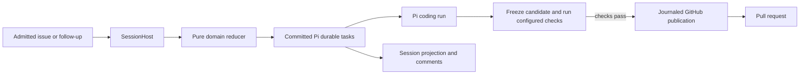
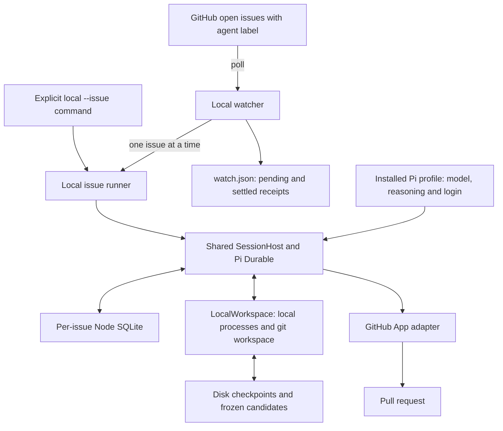
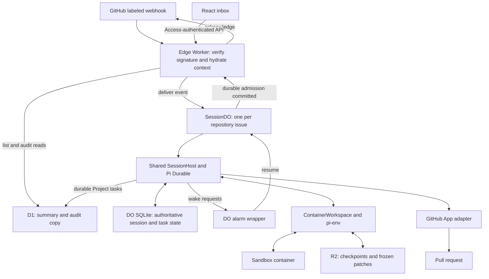

# Puchero architecture

This is the current architecture overview. Start here for what exists, what runs
locally, and what remains future work. Operational commands live in the
[agent guide](../apps/agent/README.md); detailed designs are linked below.

Puchero turns an issue in one configured GitHub repository into code changes,
runs configured checks against a frozen candidate, and opens a PR when they pass.
Review and merging happen on GitHub. There is no pre-publication approval mode
and Puchero never merges automatically.

## Implementation and deployment status

| Path or capability                                                            | Status                                                                                           |
| ----------------------------------------------------------------------------- | ------------------------------------------------------------------------------------------------ |
| Local issue runner and label watcher                                          | Implemented; exercised end to end with the real Pi login and GitHub App                          |
| Cloudflare Worker, SessionDO, Container/R2 and React/D1 inbox                 | Implemented and exercised in local development; deployed Cloudflare operation remains unverified |
| React inbox for local SQLite sessions                                         | Not connected; the inbox reads the Worker/SessionDO path                                         |
| Slack, cron and general-purpose tool/result sessions                          | Future work                                                                                      |
| Global/per-team SchedulerDO, multi-user scheduling and parallel local workers | Future work                                                                                      |
| Automatic retry of terminal sessions and post-PR CI/review repair             | Future work                                                                                      |
| P-Stack or other agent-skill loading                                          | Not integrated into the durable harness                                                          |

The local and Cloudflare paths reuse the same session core. They are execution
adapters, not separate agent implementations. The diagrams below distinguish
application control flow from the storage each path owns.

## Shared session core

- **Domain authority:** [`packages/domain/src/session.ts`](../packages/domain/src/session.ts)
  decides transitions, run/version identity, attempt limits, steering, Stop and
  publication. The model cannot declare validation successful.
- **Durable execution:** [`session-host.ts`](../apps/agent/src/session-host.ts)
  commits reducer state and instruction tasks together in Pi Durable storage.
  Tasks perform effects and record their outcomes. A restart resumes committed
  work; ambiguous GitHub publication reconciles against the saved journal.
- **Workspace:** [`ports.ts`](../apps/agent/src/ports.ts) defines the workspace and
  GitHub interfaces. [`git-workspace.ts`](../apps/agent/src/git-workspace.ts)
  implements checkpoint/restore and immutable candidate validation over a Pi
  execution environment. Coding tools checkpoint after write, edit and bash.
- **Publication:** [`github-app.ts`](../apps/agent/src/github-app.ts) keeps App
  credentials on the host and journals Git objects, branch and PR receipts.
  It creates branches without overwriting existing refs. Remote calls are
  idempotent or reconciled; there is no transaction spanning SQLite and GitHub.

The current lifecycle is `idle → running → validating → publishing → published`,
with bounded failure paths and cancellation before publication. Failed and
cancelled sessions have no public restart action. Legacy approval fields remain
readable for stored-state compatibility; they do not select a current mode.
See [automatic publication](design/automatic-pr.md) and
[session fault handling](design/session-faults.md).

## Local execution: the current operational path

[`local-cli.ts`](../apps/agent/src/local-cli.ts) loads the installed Pi profile
through Pi's official `ModelRuntime` and `SettingsManager`. Pi owns credential
refresh and persistence. Puchero retains its own durable tools and task context;
interactive Pi skills, extensions and prompts are not imported.

[`local-watch.ts`](../apps/agent/src/local-watch.ts) records pending issues before
opening them and saves settlement receipts to avoid repeated terminal work.
[`local-runner.ts`](../apps/agent/src/local-runner.ts) owns each issue's SQLite,
workspace and kernel lock. Default state is under
`~/.local/state/puchero/OWNER/REPO/ISSUE`; watch receipts sit in the repository
directory. Returning to the same directory resumes its saved session.

The watcher is serial and checks eligibility at scan time. Restarting the command
resumes pending work; there is no installed supervisor or automatic process
restart. First signal stops watch admission and finishes the current issue;
the single-issue command instead requests Stop. See
[local Pi](design/local-pi.md) and [watch recovery](design/local-watch.md).

Local tools run with the current user's filesystem permissions. A minimal child
environment and separate HOME do not make a filesystem sandbox. Checkpoints and
patches are disk-backed, and local projections are a no-op: this path uses no
Worker, SessionDO, D1 or R2, and does not feed the React inbox.

## Cloudflare execution: implemented, deployment unverified

[`worker.ts`](../apps/agent/src/worker.ts) exposes signed GitHub admission and the
authenticated inbox API. [`SessionDO.ts`](../apps/agent/src/SessionDO.ts) opens the
same session host over DO SQLite, connects its wake requests to one alarm wrapper,
and supplies the Container/R2 workspace and D1 projection adapters.

D1 is a delayed, rebuildable-in-principle projection, not decision authority;
there is no global enumeration/rebuild command. Detail and decisions read the
session. Projection and GitHub effects are Pi durable instruction tasks, not an
additional independent outbox drain. The React inbox can show state, evidence,
diffs and the PR, and send instructions or eligible Stop requests.

The Worker reads explicit deployment credentials and model configuration, not
this machine's Pi login. Local Cloudflare development uses faux models and fake
GitHub; the production configuration uses the real adapters. Container internet
is disabled and required validation dependencies must be supplied in the image.
See the [cloud development/configuration guide](../apps/agent/README.md).

There is currently no SchedulerDO or global cloud run-slot allocator. A DO owns
one issue, but that does not impose a global concurrency limit.

## Earlier diagrams and future work

The Worker/SessionDO/Container diagram describes the cloud path above. The
general-purpose “any trigger → session → tools → results” diagram describes a
possible broader product, not implemented Slack/cron/Notion support. The diagram
containing SchedulerDO describes future concurrency and team policy, not a
module currently in this repository. Neither future shape is a deployment plan.

Progress/status for local runs, watcher supervision, explicit terminal retries,
CI/review follow-ups, stronger local isolation and per-task resource limits remain
separate work. Agent skills can guide coding and verification inside a session;
they do not supply those runtime guarantees.

## Repository and document map

| Location                                         | Purpose                                                                                      |
| ------------------------------------------------ | -------------------------------------------------------------------------------------------- |
| [`PRODUCT.md`](../PRODUCT.md)                    | Current product behavior and inbox scope                                                     |
| [`apps/agent`](../apps/agent)                    | Shared host, local CLI/watch and Cloudflare adapters                                         |
| [`packages/domain`](../packages/domain)          | Pure session model and transitions                                                           |
| [`packages/contracts`](../packages/contracts)    | Shared inbox request/response contracts                                                      |
| [`apps/web`](../apps/web)                        | React inbox for the Worker backend                                                           |
| [`apps/api`](../apps/api)                        | Separate Node/PostgreSQL starter API; not agent state or a requirement for local runs        |
| [`design/milestone-1.md`](design/milestone-1.md) | Historical plan and as-built rationale; later designs supersede its old policy/approval flow |
| [`research`](research)                           | Time-pinned comparisons and experiments, not current implementation status                   |

Keep this overview aligned when triggers, state ownership, storage, execution
adapters, publication behavior or deployment status change. Detailed designs
explain individual decisions; historical plans should not override this overview.
